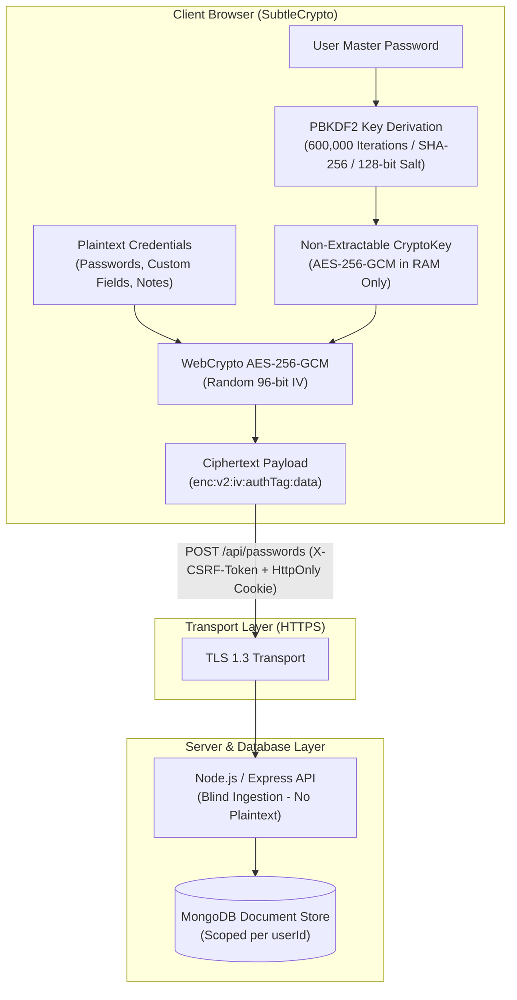
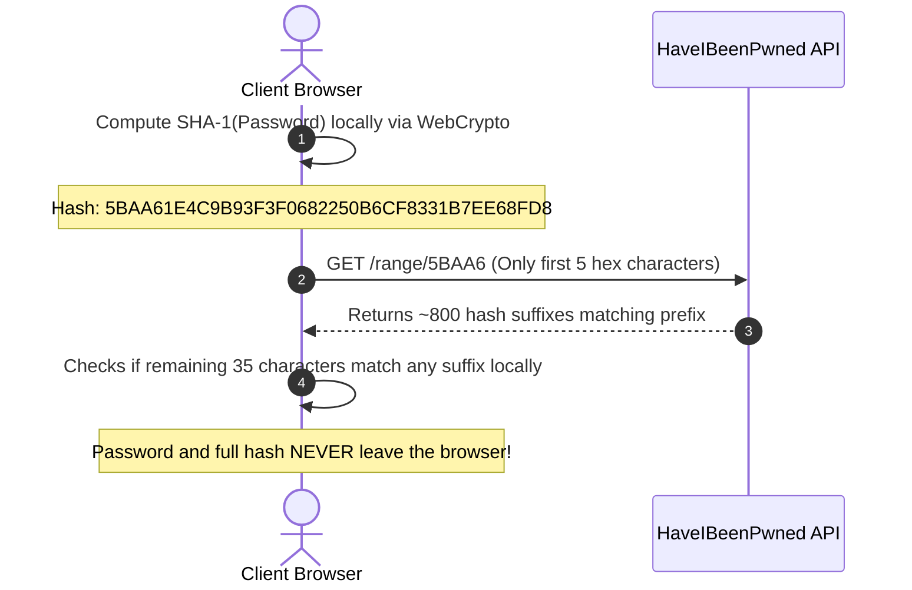

# 🛡️ PassVault (PassOP) — Enterprise-Grade Interactive Password Manager & Zero-Knowledge Vault

[](https://react.dev/)
[](https://vitejs.dev/)
[](https://tailwindcss.com/)
[](https://developer.mozilla.org/en-US/docs/Web/API/Web_Crypto_API)
[](https://threejs.org/)
[](https://lenis.darkroom.engineering/)
[](https://expressjs.com/)
[](https://www.mongodb.com/)
[](https://owasp.org/www-community/attacks/csrf)

An enterprise-grade, zero-knowledge, full-stack password security vault and high-performance interactive web application. Engineered with **React 19**, **WebCrypto AES-256-GCM**, **Three.js**, **Express 5**, and **MongoDB**, featuring **Linear/Apple-inspired motion design**, client-side cryptographic isolation, real-time breach detection, encrypted one-time secret sharing, and multi-tenant security architecture.

> **Project status:** PassVault is actively developed. Review the deployment and security notes before exposing an instance to the public internet.

---

## 🚀 Key Milestones & What's New

PassVault has evolved from a basic credential CRUD into a production-hardened, defense-in-depth password vault:

- [x] **Client-Side Zero-Knowledge Encryption (`cryptoVault.js`)**:
  - Full end-to-end encryption in the browser using the native **Web Crypto API (SubtleCrypto)**.
  - Master key derived via **PBKDF2 with 600,000 iterations (NIST SP 800-132 recommendation)** and 128-bit random device/user salt.
  - **AES-256-GCM** encryption for passwords, notes, and custom fields with a random 96-bit IV and 128-bit authentication tag (`enc:v2:...`).
  - Cryptographic keys live **exclusively in RAM** as non-extractable `CryptoKey` instances; never stored in `localStorage` or `sessionStorage`.
  - Backend and database **never receive or store plaintext credentials**.

- [x] **PassVault Send — End-to-End Encrypted One-Time Secret Sharing (`VaultSendModal.jsx`, `VaultSendViewer.jsx`)**:
  - Create and share temporary, self-destructing encrypted links for passwords, text tokens, or secure notes.
  - Configurable expiration (1 minute to 7 days) and view limit (1 to 100 views) with automatic burn-after-reading.
  - Optional secondary passphrase protection derived with client-side SHA-256 challenge.
  - Sender dashboard to monitor remaining views or immediately burn/revoke access.

- [x] **Privacy-Preserving Breach Detection & Vault Health Audit (`breachCheck.js`, `VaultSecurityAudit.jsx`)**:
  - Direct integration with HaveIBeenPwned API using the **k-Anonymity model**.
  - Passwords are SHA-1 hashed in the browser; only the first 5 characters are dispatched over the network.
  - Vault security audit score (0–100%, Grade A+ to F) evaluating pwned passwords, reused credentials, weak entropy, and stale entries (>90 days).
  - 1-click filter pills to locate and patch vulnerable credentials immediately.

- [x] **Inactivity Auto-Lock & 4-Digit Quick PIN Unlock (`useAutoLock.js`, `LockScreenModal.jsx`, `pinAuth.js`)**:
  - Multi-event idle detection (cursor movement, keystrokes, scroll, tab visibility changes).
  - Configurable auto-lock timeouts (1, 5, 15, 30, or 60 minutes) or instant manual locking (`Cmd/Ctrl + L`).
  - Quick 4-digit PIN unlock option using WebCrypto PBKDF2 with progressive brute-force lockout backoff.
  - Instant memory scrubbing of decrypted state and cryptographic keys on vault lock.

- [x] **1-Click Vault Migration & Import/Export (`vaultMigration.js`, `VaultMigrationModal.jsx`)**:
  - Seamless import from **Google Chrome, Mozilla Firefox, Bitwarden, 1Password, and Dashlane** CSV exports.
  - Export vault to plaintext CSV, plaintext JSON, or **Zero-Knowledge Encrypted JSON** (passphrase-protected).
  - Pre-import validation, XSS sanitization, duplicate detection, and high-speed bulk ingestion API (`/api/passwords/bulk`).

- [x] **Advanced Password & Memorable Diceware Passphrase Generator (`PasswordGeneratorModal.jsx`, `passphraseGenerator.js`)**:
  - High-entropy cryptographic random passwords with custom sets (uppercase, lowercase, numbers, symbols, ambiguous filter).
  - Memorable Diceware multi-word passphrases (3–8 words, custom separators, capitalizations, appended numbers).
  - Real-time Shannon entropy calculation (bits) and estimated offline/online crack-time visualization.

- [x] **Zero-Knowledge Password Version History (`PasswordHistoryModal.jsx`)**:
  - Automatically records up to 5 historical versions when a credential password changes.
  - Historical snapshots are client-side encrypted before network transmission.
  - Timestamped change logs with reveal, copy, and 1-click credential rollback/restoration actions.
  - Explicit history clearing from the password history timeline.

- [x] **Dynamic Custom Fields & Organization (`Manager.jsx`)**:
  - Add arbitrary encrypted custom fields (API tokens, recovery codes, PINs, security questions).
  - 5 category folders: **Personal, Work, Finance, Development, Social**.
  - ⭐ Favorites quick-starring filter and tag filter pills.
  - Instant search across site names, usernames, and categories with keyboard shortcut (`Cmd/Ctrl + K`).

- [x] **Enterprise Security Hardening & Anti-CSRF Defense (`server.js`, `csrf.js`)**:
  - **Double-Submit Cookie Anti-CSRF** architecture with `XSRF-TOKEN` cookie and `X-CSRF-Token` headers verified via `crypto.timingSafeEqual`.
  - **HttpOnly, Secure, SameSite** session cookies mitigating XSS exfiltration risks.
  - Comprehensive remediation of 19 security vulnerabilities (PIN auth, non-extractable keys, input sanitization, rate limiting, and memory clearing).
  - Fallback server-side AES-256-GCM encryption (`enc:v1:...`) for multi-tier defense in depth.

- [x] **Interactive 3D Cryptographic Network Globe & Motion Aesthetics**:
  - Three.js particle canvas with dynamic cryptographic node constellations and orbital arcs.
  - Custom React motion hooks: `useSpotlight`, `useTilt`, `useScrollReveal`, `useMagnetic`.
  - Inertial momentum scrolling powered by **Lenis**.
  - Dark mode and light mode theme support with persistent preferences.

---

## 🔁 Password History Workflow

Password history is available from the history action in the credential list:

1. Change a credential's password and save it. The previous value is encrypted in the browser and added to the beginning of its history.
2. Open the history action to view the active password and its timestamped previous versions.
3. Use **Reveal** or **Copy** for an individual version, or choose **Restore** to make that version active again.
4. Choose **Clear History** to permanently remove all previous versions for that credential. The active password is not deleted.

Only password changes create history entries; edits to metadata, tags, favorites, or custom fields do not. History is capped at the five most recent versions per credential.

---

## 🏛️ Cryptographic Architecture

PassVault follows strict **Zero-Knowledge** principles. The encryption key never leaves the client device, and the remote database only ever receives opaque ciphertext.



### Privacy-Preserving Breach Detection (k-Anonymity)



---

## 🌟 Features Breakdown

### 1. 🔑 Zero-Knowledge Personal Vault
- **Encrypted Storage**: Securely organize credentials by website, username, password, custom fields, and notes.
- **Dynamic Custom Fields**: Add arbitrary key-value pairs (API keys, security PINs, server secrets) encrypted with the user's master key.
- **Brand Detection**: Automatic favicon & brand logo resolution for 30+ major platforms (Google, GitHub, AWS, Netflix, Stripe) with dual fallback.
- **Copy & Masking**: Discreet one-click password/custom field visibility toggles and clipboard copying with self-clearing toast notices.

### 2. ⚡ PassVault Send (Encrypted Secret Dispatch)
- **Zero-Knowledge Disposable Links**: Share sensitive secrets with teammates or clients without account requirements.
- **Configurable Lifespan**: Set expiration between 1 minute and 7 days.
- **View Burn Limits**: Enforce strict view quotas (1 to 100 views); permanently deletes after threshold is reached.
- **Optional Challenge Passphrase**: Require the recipient to input a pre-shared passphrase to decrypt the payload.

### 3. 🛡️ Security Health Audit & Breach Scanner
- **Live Scoring**: Instant security grade (A+ through F) based on password strength, age, reuse, and breach status.
- **Pwned Detection**: Continuous k-anonymity checks alerting users if a password has been compromised in public data leaks.
- **Stale Password Warnings**: Identifies credentials that have not been updated in over 90 days.

### 4. 🎲 Memorable Passphrase & Custom Generator
- **Diceware Generator**: Create human-memorable passphrases (e.g. `correct-horse-battery-staple`) with custom delimiters and capitalization.
- **Entropy Engine**: Cryptographically secure pseudo-random generation with instant entropy bits and offline crack-time estimates.

### 5. ⏱️ Inactivity Auto-Lock & 4-Digit PIN
- **Idle Detection**: Monitors idle intervals across user interactions and background tab switches.
- **4-Digit Quick PIN**: Allows rapid re-authentication without typing complex master passwords repeatedly.
- **Brute-Force Lockout Defense**: Progressive lockout delays after successive failed attempts.

### 6. 🔄 1-Click Vault Migration
- **Universal Importer**: Parse and import CSV credential exports from Chrome, Firefox, Bitwarden, 1Password, and Dashlane.
- **Safe Export**: Create encrypted JSON backups or plaintext CSV files with explicit user confirmation and sanitization.

---

## 🛠️ Tech Stack & Architecture

### Frontend
| Technology | Role |
|---|---|
| **React 19.2** | UI component architecture and modern hooks (`useActionState`, `useMemo`, `useId`) |
| **Vite 8.0** | High-performance bundling and instant HMR development server |
| **Tailwind CSS v4** | Modern utility-first styling with design tokens and dark mode support |
| **Web Crypto API** | Native in-browser AES-256-GCM encryption and PBKDF2 key derivation |
| **Three.js** | 3D WebGL cryptographic particle globe visualizer |
| **Lenis** | Inertial smooth scrolling with `prefers-reduced-motion` compliance |
| **GSAP** | Fluid motion interpolation and spring animations |
| **Phosphor Icons** | Clean, minimalist icon system |
| **React Toastify** | Accessible, toast feedback notifications |
| **UUID (v4)** | Unique client-side record key generation |

### Backend
| Technology | Role |
|---|---|
| **Node.js & Express 5.2** | Asynchronous RESTful API service |
| **MongoDB Native Driver (v7.3)** | Document database with compound indexes and TTL collections |
| **Double-Submit Anti-CSRF** | Custom CSRF verification middleware matching `XSRF-TOKEN` cookie to headers |
| **jsonwebtoken (JWT)** | Stateless bearer token and session authorization |
| **bcryptjs** | Adaptive password hashing with 12 salt rounds for master user accounts |
| **cookie-parser** | HttpOnly cookie session handling |
| **dotenv & CORS** | Environment configuration and whitelisted cross-origin security |

---

## 📁 Repository Structure

```
PasswordProject/
├── backend/
│   ├── .env.example              # Sample backend configuration
│   ├── package.json              # Express & MongoDB dependencies
│   └── server.js                 # API routes, auth, anti-CSRF, crypto fallback & DB indexes
├── src/
│   ├── assets/                   # Vector logos, monograms & security visual assets
│   ├── Component/
│   │   ├── Auth.jsx              # Master registration & login modal with key derivation
│   │   ├── CryptographicNetworkGlobe.jsx  # Three.js 3D interactive particle globe
│   │   ├── Footer.jsx            # App footer with telemetry status signals
│   │   ├── LandingPage.jsx       # Linear-style interactive showcase & live cipher sandbox
│   │   ├── LockScreenModal.jsx   # Inactivity lock screen with 4-digit PIN unlock
│   │   ├── Manger.jsx            # Vault manager (CRUD, search, tags, custom fields, logos)
│   │   ├── NavBar.jsx            # Responsive navigation, theme toggle & session controls
│   │   ├── PassVaultLogo.jsx     # Geometric brand monogram and wordmark
│   │   ├── PasswordGeneratorModal.jsx # Passphrase & custom entropy generator modal
│   │   ├── PasswordHistoryModal.jsx   # Zero-knowledge credential version history & restore
│   │   ├── SiteLogo.jsx          # Domain logo resolution engine with dual fallback
│   │   ├── VaultDefenseExperience.jsx # Interactive cryptographic audit & defense shield
│   │   ├── VaultMigrationModal.jsx    # CSV/JSON import, export & bulk migration modal
│   │   ├── VaultSecurityAudit.jsx     # HaveIBeenPwned breach detection & health scoring
│   │   ├── VaultSendModal.jsx         # PassVault Send creator & active links manager
│   │   └── VaultSendViewer.jsx        # Public decryption viewer for one-time shared secrets
│   ├── hooks/
│   │   ├── useAutoLock.js        # Inactivity tracking and session lock lifecycle hook
│   │   ├── useMotion.js          # Spotlight, Tilt, ScrollReveal & Magnetic physics hooks
│   │   └── useSmoothScroll.js    # Lenis inertial scroll integration
│   ├── utils/
│   │   ├── breachCheck.js        # Privacy-preserving k-Anonymity HIBP breach client
│   │   ├── cryptoVault.js        # WebCrypto AES-256-GCM & PBKDF2 (600k rounds) engine
│   │   ├── csrf.js               # Double-Submit anti-CSRF client utility & secureFetch
│   │   ├── passphraseGenerator.js# Diceware wordlist & cryptographic entropy generator
│   │   ├── pinAuth.js            # PIN hashing, lockout tracking & timeout persistence
│   │   └── vaultMigration.js     # CSV/JSON parsers, XSS sanitizer & RFC 4180 exporter
│   ├── App.jsx                   # Central controller, session orchestrator & views
│   ├── index.css                 # Tailwind tokens, keyframes & glassmorphism utilities
│   └── main.jsx                  # React 19 application entry point
├── index.html
├── package.json
├── tailwind.config.js
└── vite.config.js
```

---

## ⚡ Getting Started

### Prerequisites
- **Node.js**: v18.0.0 or later (v20+ recommended)
- **MongoDB**: Local MongoDB instance (`mongodb://127.0.0.1:27017`) or MongoDB Atlas URI
- A modern browser with **Web Crypto API** support

---

### 1. Backend Setup

1. Open a terminal and navigate to the backend directory:
   ```bash
   cd PasswordProject/backend
   ```

2. Install dependencies:
   ```bash
   npm install
   ```

3. Configure environment variables:
   ```bash
   cp .env.example .env
   ```
   Ensure `.env` contains:
   ```env
   MONGO_URL=mongodb://127.0.0.1:27017/passOP
   DB_NAME=passOP
   PORT=3000
   CORS_ORIGIN=http://localhost:5173
   JWT_SECRET=your-super-strong-jwt-secret-key-here
   NODE_ENV=development
   VAULT_ENCRYPTION_KEY=your-long-random-encryption-key-here
   ```

   `JWT_SECRET` and `VAULT_ENCRYPTION_KEY` must be long, randomly generated values in any real deployment. Never commit `.env` or reuse the example values.

4. Start the backend service:
   ```bash
   npm run dev
   ```
   The backend API will run on `http://localhost:3000`.

---

### 2. Frontend Setup

1. Open a new terminal and navigate to the frontend directory:
   ```bash
   cd PasswordProject
   ```

2. Install dependencies:
   ```bash
   npm install
   ```

3. Configure environment variables:
   ```bash
   cp .env.example .env
   ```
   Ensure `.env` contains:
   ```env
   VITE_AUTH_API_URL=http://localhost:3000/api/auth
   VITE_API_BASE_URL=http://localhost:3000/api/passwords
   VITE_SENDS_API_URL=http://localhost:3000/api/sends
   ```

4. Launch the Vite development server:
   ```bash
   npm run dev
   ```

5. Open your browser and navigate to:
   ```
   http://localhost:5173
   ```

### Available scripts

Run these commands from the frontend directory:

| Command | Description |
|---|---|
| `npm run dev` | Start the Vite development server with hot reload |
| `npm run build` | Create a production build in `dist/` |
| `npm run preview` | Serve the production build locally |
| `npm run lint` | Run ESLint across the frontend |

The backend uses `npm start` and `npm run dev` to start `backend/server.js`.

---

## 📡 API Reference

All mutating routes (`POST`, `PUT`, and `DELETE`) enforce **Double-Submit Anti-CSRF protection** requiring an `X-CSRF-Token` or `X-XSRF-Token` header matching the `XSRF-TOKEN` cookie. Authenticated endpoints use the HttpOnly `passvault_token` session cookie; the API also accepts `Authorization: Bearer <token>` as a fallback for CLI tools and integrations.

### 1. Authentication & Session Endpoints
Mutating routes (`POST`, `PUT`, and `DELETE`) require a CSRF header (`X-CSRF-Token` or `X-XSRF-Token`) matching the `XSRF-TOKEN` cookie. Authenticated routes use the HttpOnly `passvault_token` session cookie; bearer authorization is also supported for integrations.

| Method | Route | Description | Auth Required | CSRF Required |
|---|---|---|:---:|:---:|
| `GET` | `/api/csrf-token` | Issue or refresh Double-Submit CSRF cookie & token | ❌ | ❌ |
| `POST` | `/api/auth/register` | Register new master account (≥12 char password) | ❌ | ✅ |
| `POST` | `/api/auth/login` | Authenticate and issue HttpOnly session cookie | ❌ | ✅ |
| `GET` | `/api/auth/me` | Verify active session on page reload | ✅ | ❌ |
| `POST` | `/api/auth/logout` | Clear session and anti-CSRF cookies | ❌ | ✅ |

### 2. Password Vault Endpoints
| Method | Route | Description | Auth Required | CSRF Required |
|---|---|---|:---:|:---:|
| `GET` | `/api/passwords` | Retrieve all encrypted vault items for user | ✅ | ❌ |
| `POST` | `/api/passwords` | Add new credential item (enc:v2: ciphertext) | ✅ | ✅ |
| `POST` | `/api/passwords/bulk` | Bulk import credentials from CSV/JSON | ✅ | ✅ |
| `PUT` | `/api/passwords/:id` | Update credential, tags, custom fields, history | ✅ | ✅ |
| `DELETE` | `/api/passwords/:id` | Delete a vault record by ID | ✅ | ✅ |

### 3. PassVault Send Endpoints
| Method | Route | Description | Auth Required | CSRF Required |
|---|---|---|:---:|:---:|
| `POST` | `/api/sends` | Create a new encrypted one-time secret | Optional | ✅ |
| `GET` | `/api/sends/meta/:id` | Check secret metadata (remaining views, expiration) | ❌ | ❌ |
| `POST` | `/api/sends/reveal/:id` | Reveal secret (verifies passphrase & burns) | ❌ | ✅ |
| `GET` | `/api/sends/my` | List active secrets created by current user | ✅ | ❌ |
| `DELETE` | `/api/sends/:id` | Sender manually revokes/burns secret | ✅ | ✅ |

### 4. Utility Endpoints
| Method | Route | Description | Auth Required | CSRF Required |
|---|---|---|:---:|:---:|
| `GET` | `/health` | Server liveness check (`{ ok: true }`) | ❌ | ❌ |
| `GET` | `/api/logo` | Resolve brand logo URL from domain query | ❌ | ❌ |
| `GET` | `/api/logo/popular` | Curated list of popular platform metadata | ❌ | ❌ |

---

## 🔒 Enterprise Security & Defense Model

PassVault is engineered with zero-trust architectural principles:

1. **Zero-Knowledge Core**: Vault passwords, notes, and custom fields are encrypted in the browser with WebCrypto before transmission. The current client format is `enc:v2`; the backend stores and returns that ciphertext without decrypting it. The server also retains an `enc:v1` AES-GCM fallback for legacy records.
2. **600,000 PBKDF2 Iterations**: Meets NIST SP 800-132 recommendations, providing heavy defense against GPU-accelerated offline dictionary and rainbow table attacks.
3. **Non-Extractable Keys**: Vault `CryptoKey` objects use `extractable: false` and remain in React memory only. Refreshing the page requires entering the master password again. The per-device KDF salt stored in local storage is not the encryption key.
4. **Anti-CSRF Double-Submit**: State changes require an authenticated cryptographic header token matching an unforgeable cookie verified via constant-time byte comparisons (`crypto.timingSafeEqual`).
5. **HttpOnly Cookie Storage**: Authentication tokens are isolated in HttpOnly, SameSite cookies to protect against script-based token theft (XSS exfiltration).
6. **Input Sanitization**: CSV imports and user inputs are strictly validated and stripped of executable tags and control characters to prevent Stored XSS.
7. **Scoped Data Isolation**: MongoDB queries strictly filter by `userId`, enforcing multi-tenant isolation across all vault operations.

### Production deployment checklist

- Use HTTPS for the frontend and backend, and set `NODE_ENV=production`.
- Set `CORS_ORIGIN` to the exact frontend origin(s), separated by commas.
- Use different, randomly generated `JWT_SECRET` and `VAULT_ENCRYPTION_KEY` values and store them in a secret manager.
- Set every `VITE_*_API_URL` value to an HTTPS API URL before building the frontend.
- Protect MongoDB with authentication, network restrictions, and backups.
- Treat plaintext exports and PassVault Send links as sensitive. Send links carry the decryption key in the URL fragment, so the complete link must be shared securely.

---

## 🗺️ Future Roadmap

- [ ] **Two-Factor Authentication (2FA / TOTP)**: Time-based one-time password integration for master account login.
- [ ] **FIDO2 / WebAuthn & Passkeys**: Hardware security key (YubiKey) and biometric passkey authentication.
- [ ] **Browser Extension**: Manifest V3 Chromium & Firefox extension companion with native auto-fill.
- [ ] **Desktop Client**: Cross-platform desktop release packaged with Tauri and Rust.
- [ ] **Emergency Vault Access**: Trusted emergency contact recovery using Shamir's Secret Sharing (SSS).

---

## 📄 License

Distributed under the **ISC License**. See `package.json` for details.
