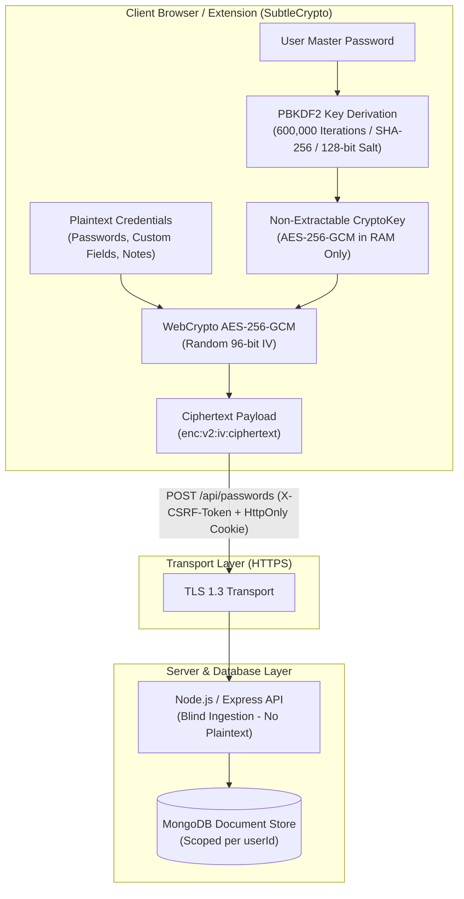
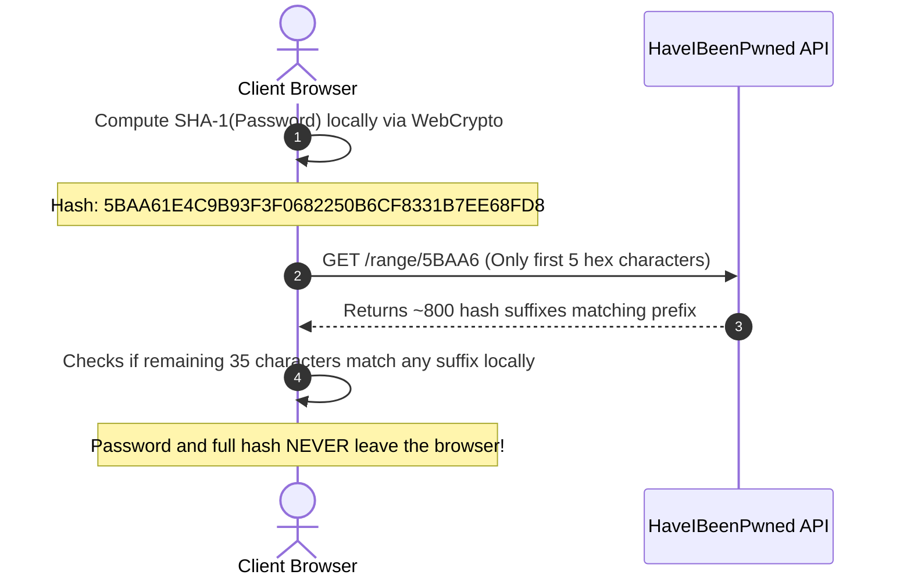

# 🛡️ PassVault — Enterprise-Grade Interactive Password Manager & Zero-Knowledge Vault

[](https://react.dev/)
[](https://vitejs.dev/)
[](https://tailwindcss.com/)
[](https://developer.mozilla.org/en-US/docs/Web/API/Web_Crypto_API)
[](https://developer.chrome.com/docs/extensions/develop)
[](https://threejs.org/)
[](https://lenis.darkroom.engineering/)
[](https://expressjs.com/)
[](https://www.mongodb.com/)
[](https://owasp.org/www-community/attacks/csrf)

An enterprise-grade, zero-knowledge, full-stack password security vault, browser extension, and high-performance interactive web application. Engineered with **React 19**, **WebCrypto AES-256-GCM**, **Manifest V3 Browser Extension**, **Three.js**, **Express 5**, and **MongoDB**, featuring **Linear/Raycast-inspired obsidian glass design**, client-side cryptographic isolation, real-time breach detection, encrypted one-time secret sharing, and a comprehensive security audit telemetry system.

---

## 🚀 Key Milestones & Features

PassVault delivers defense-in-depth, zero-knowledge password protection across both web and browser extension platforms:

### 1. 🔐 Client-Side Zero-Knowledge Encryption (`cryptoVault.js`)
- **Web Crypto API (SubtleCrypto)**: All encryption and decryption occurs strictly in the browser. The backend API only ever handles opaque ciphertext (`enc:v2:...`).
- **PBKDF2 Key Derivation**: 600,000 iterations of SHA-256 (NIST SP 800-132 2023 standard) combined with a random per-user salt and normalized email.
- **Non-Extractable Keys**: `CryptoKey` instances are instantiated with `extractable: false` and reside **exclusively in RAM** (React state). Never saved to `localStorage` or `sessionStorage`.
- **AES-256-GCM**: Industry-standard authenticated encryption with random 96-bit IVs and 128-bit authentication tags per credential.

### 2. 🧩 Manifest V3 Browser Extension (`extension/`)
- **Automatic Form Detection**: Injected content script automatically detects login forms (`<input type="password">` + username/email inputs) with React/Vue/Angular synthetic event dispatch.
- **Domain-Aware Matching**: Filters vault credentials to match the current tab's hostname in real time.
- **1-Click Auto-Fill**: Injects username and decrypted password straight into page input fields.
- **Secure Key Lifecycle**: Vault key is derived and stored in `chrome.storage.session` (in-memory, auto-cleared when browser closes, completely isolated from web pages).
- **Obsidian Dark Theme**: Designed to match the web app's aesthetics with quick search, copy-to-clipboard, and manual lock controls.

### 3. 📋 Vault Security & Access Audit Log (`AuditLogModal.jsx`, `auditLogger.js`)
- **Tamper-Evident Chronological Activity Trail**: Tracks critical security events in real-time:
  - 🔓 Vault unlocks via Master Password and 4-digit PIN
  - 📋 Passwords and secrets copied to clipboard
  - ⚠️ Failed PIN unlock attempts recorded
  - 📦 Vault export and migration actions
  - 🔗 PassVault Send creation and revocations
- **Linear/Raycast Glassmorphism UI**: Obsidian dark glass interface with telemetry counters, filter tabs, interactive radar sonar empty state, and 1-click JSON export.

### 4. ⚡ PassVault Send — Ephemeral Secret Sharing (`VaultSendModal.jsx`, `VaultSendViewer.jsx`)
- **Zero-Knowledge Disposable Links**: Share sensitive credentials and secure notes via self-destructing links.
- **URL Fragment Key**: The 256-bit AES-GCM decryption key is embedded solely in the URL fragment (`#key=...`) — the server never receives it.
- **Burn-After-Reading & Quotas**: Configurable view limits (1 to 100 views) and expiration windows (1 minute to 7 days).
- **Passphrase Challenge**: Optional secondary passphrase protection verified using local SHA-256 challenge.

### 5. 🛡️ Privacy-Preserving Breach Detection (`breachCheck.js`, `VaultSecurityAudit.jsx`)
- **k-Anonymity Model**: Direct integration with HaveIBeenPwned API. Only the first 5 characters of the SHA-1 password hash are sent over the wire; the remaining 35 characters are compared locally in the client.
- **Audit Scoring**: Live grade (A+ through F) identifying compromised, reused, weak, and stale (>90 days) credentials.

### 6. ⏱️ Inactivity Auto-Lock & Escalating PIN Defense (`LockScreenModal.jsx`, `pinAuth.js`)
- **Idle Detection**: Monitors mouse movement, keyboard strokes, wheel events, and tab visibility changes.
- **4-Digit Quick PIN**: Fast re-authentication without retyping long master passwords.
- **Escalating Lockout**: Progressive brute-force defense (5s → 30s → 2min → 10min lockout backoff).

### 7. 🎲 Diceware Passphrase & Password Generator (`PasswordGeneratorModal.jsx`, `passphraseGenerator.js`)
- **Cryptographic Random Passwords**: Configurable length, symbols, digits, and ambiguous character filtering.
- **Memorable Diceware Passphrases**: Multi-word dictionary passphrases with custom delimiters and capitalization.
- **Shannon Entropy Engine**: Real-time bit strength and offline crack-time visualization.

### 8. 🔄 1-Click Vault Migration & Import/Export (`VaultMigrationModal.jsx`, `vaultMigration.js`)
- **Universal Importer**: Seamlessly parse CSV exports from Chrome, Firefox, Bitwarden, 1Password, and Dashlane.
- **Zero-Knowledge Encrypted Export**: Export your entire vault as a passphrase-protected encrypted `.json` file or plaintext CSV/JSON.

### 9. 📄 Printable Emergency Vault Recovery Kit (`EmergencyKitModal.jsx`, `recoveryKit.js`)
- **BIP-39 24-Word Cryptographic Mnemonic**: Generates a standard 256-bit emergency recovery key with an 8-bit SHA-256 checksum across 2,048 English words.
- **1-Page Printable PDF Emergency Sheet**: Clean, high-contrast, executive layout with `@media print` styling for standard A4/Letter paper or saving directly to PDF. Includes warning notices, account salt, QR code, and signature/date lines.
- **Offline Setup & Zero-Knowledge Vault Wrapping**: Encrypts the raw vault key into a rescue ciphertext blob (`rec:v1:...`) with PBKDF2 (100k rounds) before saving to the server.
- **Full Account Recovery Workflow**: Reset master password and restore vault access without data loss via the "Forgot Master Password? Recover with Emergency Kit" flow on the login screen.
- **Interactive Checksum Verification**: Test and verify printed recovery words inside the app before physical archiving.

---

## 🏛️ Cryptographic Architecture



### k-Anonymity Breach Detection Workflow



---

## 🛠️ Tech Stack & Architecture

### Frontend
| Technology | Role |
|---|---|
| **React 19.2** | UI component architecture and modern hooks (`useActionState`, `useMemo`, `useId`) |
| **Vite 8.0** | High-performance bundling and instant HMR development server |
| **Tailwind CSS v4** | Modern utility-first styling with design tokens and dark mode support |
| **Web Crypto API** | Native in-browser AES-256-GCM encryption and PBKDF2 key derivation |
| **Three.js** | 3D WebGL cryptographic particle globe visualizer |
| **Lenis** | Inertial smooth scrolling with `prefers-reduced-motion` compliance |
| **GSAP** | Fluid motion interpolation and spring physics |
| **Phosphor Icons** | Clean, minimalist icon system |
| **React Toastify** | Accessible, toast feedback notifications |
| **UUID (v4)** | Unique client-side record key generation |

### Browser Extension
| Technology | Role |
|---|---|
| **Manifest V3** | Chrome & Edge extension standard |
| **Service Worker (`background.js`)** | Zero-knowledge decryption, session vault key derivation, fill routing |
| **Content Script (`content.js`)** | DOM login form detection, synthetic event firing for React/Vue inputs |
| **Session Storage API** | In-memory key storage isolated to extension process |

### Backend & Database
| Technology | Role |
|---|---|
| **Node.js & Express 5** | High-throughput asynchronous REST API service |
| **MongoDB Native Driver** | Scalable document store with connection pooling and compound indexes |
| **Double-Submit Anti-CSRF** | Custom CSRF verification middleware matching `XSRF-TOKEN` cookie to headers |
| **jsonwebtoken (JWT)** | Stateless bearer token and session authorization via HttpOnly cookies |
| **bcryptjs** | Adaptive password hashing with 12 salt rounds for master user accounts |
| **Helmet & Compression** | Security headers (CSP, frameguard) and gzip payload compression |
| **express-rate-limit** | Anti-brute-force rate limiting on authentication routes |

---

## 📁 Repository Structure

```
PasswordProject/
├── backend/
│   ├── .env.example              # Sample backend configuration
│   ├── package.json              # Express & MongoDB dependencies
│   └── server.js                 # API routes, auth, anti-CSRF, crypto fallback & DB indexes
├── extension/                    # Manifest V3 Chrome/Edge Extension
│   ├── manifest.json             # Extension manifest & permissions
│   ├── background.js             # Service worker: auth proxy & zero-knowledge decryption
│   ├── content.js                # Injected script: form detection & credential auto-fill
│   ├── popup.html/js/css         # Extension obsidian glass popup UI
│   ├── README_EXTENSION.md       # Extension setup and architecture guide
│   └── icons/                    # Extension icon assets (16x16 to 128x128)
├── src/
│   ├── assets/                   # Vector logos, monograms & security visual assets
│   ├── Component/
│   │   ├── AuditLogModal.jsx     # Security & access audit log with live timeline
│   │   ├── Auth.jsx              # Master registration & login modal with key derivation
│   │   ├── CryptographicNetworkGlobe.jsx  # Three.js 3D interactive particle globe
│   │   ├── Footer.jsx            # App footer with telemetry status signals
│   │   ├── LandingPage.jsx       # Linear-style interactive showcase & live cipher sandbox
│   │   ├── LockScreenModal.jsx   # Inactivity lock screen with 4-digit PIN unlock
│   │   ├── Manager.jsx           # Vault manager (CRUD, search, tags, custom fields, logos)
│   │   ├── NavBar.jsx            # Responsive navigation, theme toggle & session controls
│   │   ├── PassVaultLogo.jsx     # Geometric brand monogram and wordmark
│   │   ├── PasswordGeneratorModal.jsx # Passphrase & custom entropy generator modal
│   │   ├── PasswordHistoryModal.jsx   # Zero-knowledge credential version history & restore
│   │   ├── SiteLogo.jsx          # Domain logo resolution engine with dual fallback
│   │   ├── VaultDefenseExperience.jsx # Interactive cryptographic audit & defense shield
│   │   ├── VaultExportModal.jsx  # Encrypted vault backup and export modal
│   │   ├── VaultMigrationModal.jsx    # CSV/JSON import, export & bulk migration modal
│   │   ├── VaultSecurityAudit.jsx     # HaveIBeenPwned breach detection & health scoring
│   │   ├── VaultSendModal.jsx         # PassVault Send creator & active links manager
│   │   └── VaultSendViewer.jsx        # Public decryption viewer for one-time shared secrets
│   ├── hooks/
│   │   ├── useAutoLock.js        # Inactivity tracking and session lock lifecycle hook
│   │   ├── useMotion.js          # Spotlight, Tilt, ScrollReveal & Magnetic physics hooks
│   │   └── useSmoothScroll.js    # Lenis inertial scroll integration
│   ├── utils/
│   │   ├── auditLogger.js        # Audit trail persistence and telemetry logging
│   │   ├── breachCheck.js        # Privacy-preserving k-Anonymity HIBP breach client
│   │   ├── cryptoVault.js        # WebCrypto AES-256-GCM & PBKDF2 (600k rounds) engine
│   │   ├── csrf.js               # Double-Submit anti-CSRF client utility & secureFetch
│   │   ├── passphraseGenerator.js# Diceware wordlist & cryptographic entropy generator
│   │   ├── pinAuth.js            # PIN hashing, lockout tracking & timeout persistence
│   │   └── vaultMigration.js     # CSV/JSON parsers, XSS sanitizer & RFC 4180 exporter
│   ├── App.jsx                   # Central controller, session orchestrator & views
│   ├── index.css                 # Tailwind tokens, keyframes & glassmorphism utilities
│   └── main.jsx                  # React 19 application entry point
├── index.html
├── package.json
├── tailwind.config.js
└── vite.config.js
```

---

## ⚡ Getting Started

### Prerequisites
- **Node.js**: v18.0.0 or later (v20+ recommended)
- **MongoDB**: Local MongoDB instance (`mongodb://127.0.0.1:27017`) or MongoDB Atlas URI
- **Google Chrome** or **Microsoft Edge** (for the extension)

---

### 1. Backend Setup

1. Open a terminal and navigate to the backend directory:
   ```bash
   cd PasswordProject/backend
   npm install
   ```

2. Configure environment variables in `backend/.env`:
   ```env
   MONGO_URL=mongodb://127.0.0.1:27017/passOP
   DB_NAME=passOP
   PORT=3000
   CORS_ORIGIN=http://localhost:5173
   JWT_SECRET=your-super-strong-jwt-secret-key-here
   VAULT_ENCRYPTION_KEY=your-32-byte-hex-encryption-key-here
   NODE_ENV=development
   BCRYPT_ROUNDS=12
   ```

3. Start the backend service:
   ```bash
   node server.js
   ```
   The backend API will run on `http://localhost:3000` (Health check: `http://localhost:3000/health`).

---

### 2. Frontend Setup

1. In a second terminal, navigate to the frontend directory:
   ```bash
   cd PasswordProject
   npm install
   ```

2. Configure environment variables in root `.env`:
   ```env
   VITE_AUTH_API_URL=http://localhost:3000/api/auth
   VITE_API_BASE_URL=http://localhost:3000/api/passwords
   VITE_SENDS_API_URL=http://localhost:3000/api/sends
   ```

3. Launch the Vite development server:
   ```bash
   npm run dev
   ```

4. Open your browser and navigate to:
   ```
   http://localhost:5173
   ```

---

### 3. Load the Browser Extension (Chrome / Edge)

1. Open your browser and navigate to `chrome://extensions` (or `edge://extensions`).
2. Toggle on **Developer mode** in the upper-right corner.
3. Click **Load unpacked** and select the folder:
   ```
   PasswordProject/extension
   ```
4. Click the PassVault extension icon in your toolbar, log in with your email and master password, and navigate to any site to auto-fill credentials!

---

## 📡 API Reference

All mutating routes (`POST`, `PUT`, `DELETE`) enforce **Double-Submit Anti-CSRF protection** requiring an `X-CSRF-Token` header matching the `XSRF-TOKEN` cookie. Authenticated endpoints use **HttpOnly session cookies** (with fallback to `Authorization: Bearer <token>`).

### 1. Authentication & Session Endpoints
| Method | Route | Description | Auth Required | CSRF Required |
|---|---|---|:---:|:---:|
| `GET` | `/api/csrf-token` | Issue or refresh Double-Submit CSRF cookie & token | ❌ | ❌ |
| `POST` | `/api/auth/register` | Register new master account (≥12 char password) | ❌ | ✅ |
| `POST` | `/api/auth/login` | Authenticate and issue HttpOnly session cookie | ❌ | ✅ |
| `GET` | `/api/auth/me` | Verify active session on page reload | ✅ | ❌ |
| `POST` | `/api/auth/logout` | Clear session and anti-CSRF cookies | ❌ | ✅ |

### 2. Password Vault Endpoints
| Method | Route | Description | Auth Required | CSRF Required |
|---|---|---|:---:|:---:|
| `GET` | `/api/passwords` | Retrieve all encrypted vault items for user | ✅ | ❌ |
| `POST` | `/api/passwords` | Add new credential item (`enc:v2:...` ciphertext) | ✅ | ✅ |
| `POST` | `/api/passwords/bulk` | Bulk import credentials from CSV/JSON | ✅ | ✅ |
| `PUT` | `/api/passwords/:id` | Update credential, tags, custom fields, history | ✅ | ✅ |
| `DELETE` | `/api/passwords/:id` | Delete a vault record by ID | ✅ | ✅ |

### 3. PassVault Send Endpoints
| Method | Route | Description | Auth Required | CSRF Required |
|---|---|---|:---:|:---:|
| `POST` | `/api/sends` | Create a new encrypted one-time secret | Optional | ✅ |
| `GET` | `/api/sends/meta/:id` | Check secret metadata (remaining views, expiration) | ❌ | ❌ |
| `POST` | `/api/sends/reveal/:id` | Reveal secret (verifies passphrase & burns) | ❌ | ✅ |
| `GET` | `/api/sends/my` | List active secrets created by current user | ✅ | ❌ |
| `DELETE` | `/api/sends/:id` | Sender manually revokes/burns secret | ✅ | ✅ |

### 4. Utility Endpoints
| Method | Route | Description | Auth Required | CSRF Required |
|---|---|---|:---:|:---:|
| `GET` | `/health` | Server liveness check (`{ ok: true }`) | ❌ | ❌ |
| `GET` | `/api/logo` | Resolve brand logo URL from domain query | ❌ | ❌ |
| `GET` | `/api/logo/popular` | Curated list of popular platform metadata | ❌ | ❌ |

---

## 🔒 Enterprise Security & Defense Model

PassVault is engineered with zero-trust architectural principles:

1. **Zero-Knowledge Core**: Plaintext passwords, notes, and custom fields never leave the client's browser. Encryption occurs before any network transmission using standard WebCrypto APIs.
2. **600,000 PBKDF2 Iterations**: Meets NIST SP 800-132 recommendations, providing heavy defense against GPU-accelerated offline dictionary and rainbow table attacks.
3. **Non-Extractable Keys**: CryptoKey objects are instantiated with `extractable: false`, preventing external scripts or extensions from reading raw key bytes out of browser memory.
4. **Anti-CSRF Double-Submit**: State changes require an authenticated cryptographic header token matching an unforgeable cookie verified via constant-time byte comparisons (`crypto.timingSafeEqual`).
5. **HttpOnly Cookie Storage**: Authentication tokens are isolated in HttpOnly, SameSite cookies to protect against script-based token theft (XSS exfiltration).
6. **Input Sanitization**: CSV imports and user inputs are strictly validated and stripped of executable tags and control characters to prevent Stored XSS.
7. **Scoped Data Isolation**: MongoDB queries strictly filter by `userId`, enforcing multi-tenant isolation across all vault operations.
8. **Rate Limiting & Defense**: Auth routes are capped to prevent credential stuffing; 200KB payload limits block memory flooding.

---

## 📄 License

Distributed under the **ISC License**. See `package.json` for details.
